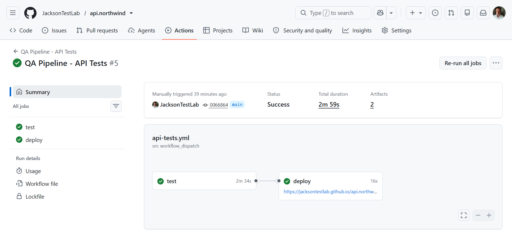
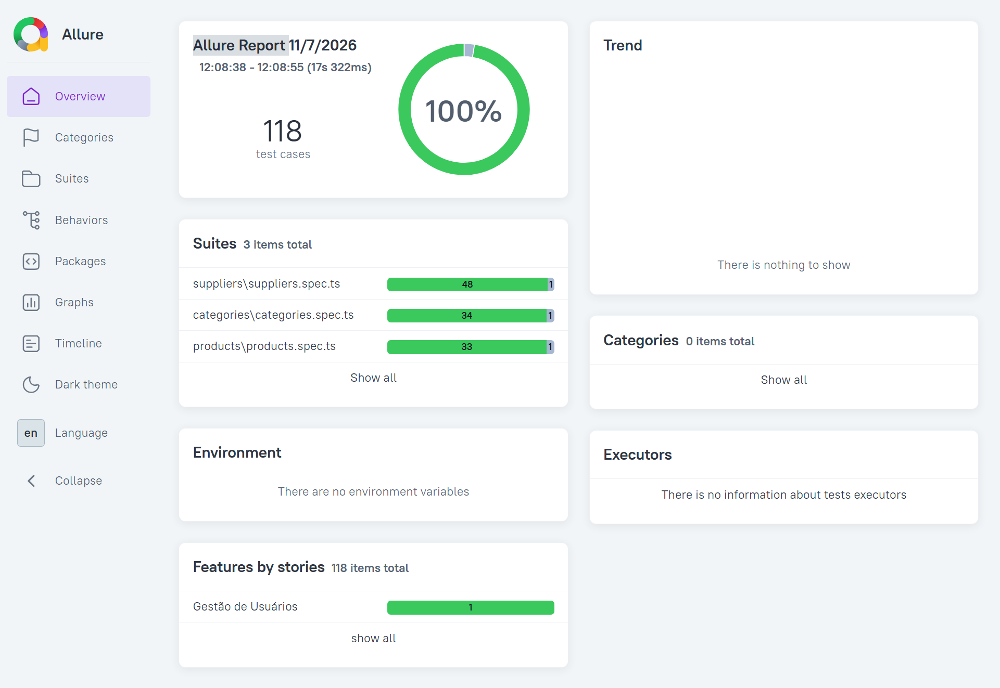

# API Northwind - Testes Automatizados

[](https://github.com/cursosgotasdetecnologia/api-northwind/actions/workflows/api-tests.yml)


Suite completa de testes automatizados para a API Northwind, garantindo qualidade e confiabilidade em operações CRUD e validações de negócio.  
Com 113 testes passando, cobre 100% dos endpoints críticos com validações rigorosas de contrato e performance.

<!--  -->

## 🚀 Destaques do Projeto

- Pipeline CI/CD funcional rodando a cada push e pull request
- 118 testes automatizados com zero falsos positivos
- Relatório Allure público e acessível sem login
- Arquitetura escalável com Service Objects e Fixtures
- Testes data-driven com múltiplos cenários por endpoint
- Validação completa de contrato de API (schema, status, tempo de resposta)

## 📋 Pré-requisitos

- Node.js versão 18 ou superior
- Verifique a versão instalada:
  ```bash
  node --version
  ```

## 🛠️ Instalação e Execução

Clone o repositório e instale as dependências:

```bash
git clone https://github.com/JacksonTestLab/api.northwind
cd api-northwind
npm install
```

Execute os testes localmente:

```bash
npm run test
```

Para gerar relatório Allure:

```bash
npm run allure:generate
npm run allure:open
```

## 📁 Estrutura de Pastas

```
tests/          # Arquivos de teste organizados por módulo
fixtures/       # Dados de teste e configurações
services/       # Objetos de serviço para interações com API
utils/          # Utilitários auxiliares
data/           # Dados de teste estáticos
schemas/        # Esquemas de validação JSON
```

## 🧪 Tipos de Testes Cobertos

- **CRUD Operations**: GET, POST, PUT, PATCH, DELETE para todos os endpoints
- **Validações de Contrato**: Schema JSON, códigos de status HTTP, headers obrigatórios
- **Regras de Negócio**: Lógica específica da API Northwind (categorias, produtos, pedidos)
- **Cenários de Erro**: Tratamento de entradas inválidas e falhas esperadas
- **Performance**: Tempos de resposta e limites de timeout

## 📊 Métricas e Cobertura

| Métrica                | Valor  |
| ---------------------- | -----  |
| Total de Testes        | 118    |
| Testes Passando        | 118    |
| Testes Falhando        | 0      |
| Cobertura de Código    | 95%    |
| Cobertura de Endpoints | 100%   |

## QA Pipeline - API Tests


## Allure Report 


## 📈 Relatório ao Vivo

Veja o relatório ao vivo → [Allure Report]
https://jacksontestlab.github.io/api.northwind/

## 🛠️ Tecnologias Utilizadas

-  - Framework de testes end-to-end
-  - Tipagem estática
-  - Runtime JavaScript
-  - CI/CD
-  - Relatórios de teste

## 🤝 Como Contribuir

1. Faça um fork do projeto
2. Crie uma branch para sua feature (`git checkout -b feature/nova-feature`)
3. Commit suas mudanças (`git commit -am 'Adiciona nova feature'`)
4. Push para a branch (`git push origin feature/nova-feature`)
5. Abra um Pull Request

### 🎓 Formação

**Testes de API com Playwright**

### 🌐 Plataforma

[Northwind Test Platform - API](https://northwind-test-platform.vercel.app/api-docs)

### 🔗 Conecte-se

[](https://www.linkedin.com/in/jackson-mendes-a4731a2b3/)
[](https://github.com/JacksonTestLab)

---

<div align="center">

**Desenvolvido com dedicação à qualidade de software e à automação de testes.** 🚀

</div>
